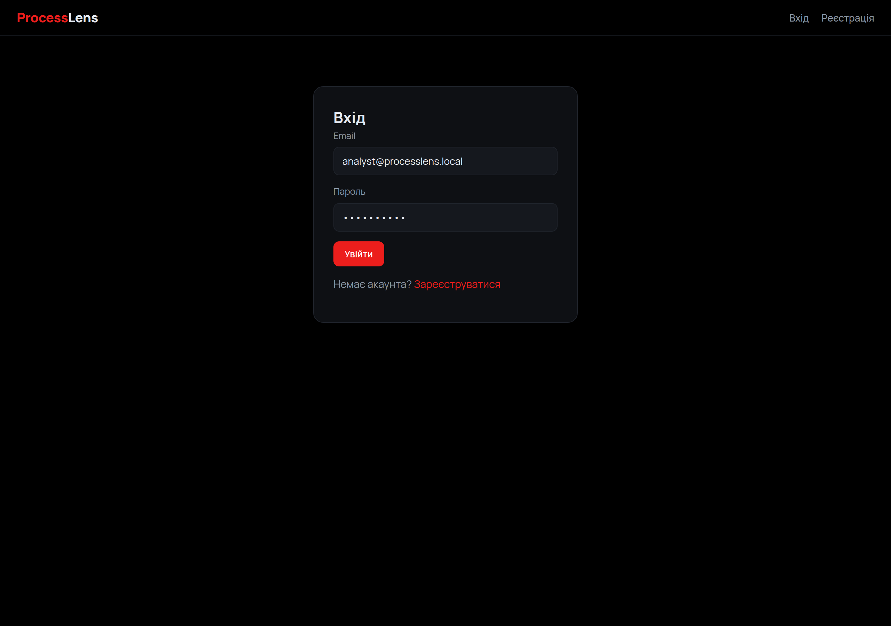
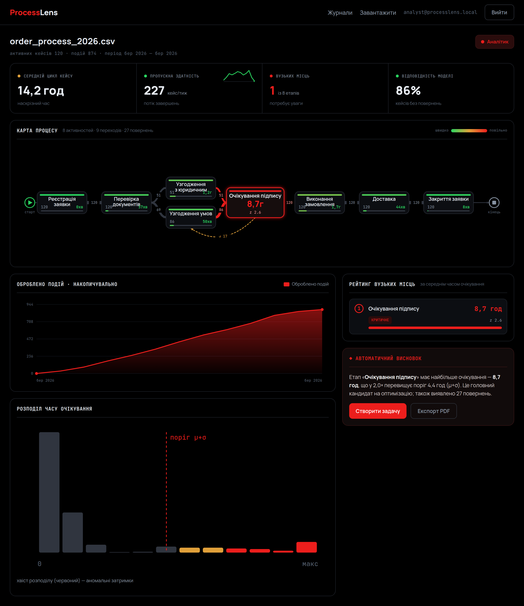

# ProcessLens · клієнтська частина (React)

> Лабораторна робота №4 — **Вебпрограмування**
> Виконав: **Коваль Денис**

| | |
|---|---|
| **Застосунок** | ProcessLens — пошук «вузьких місць» у бізнес-процесах |
| **Частина** | клієнтська (SPA) |
| **Стек** | React 18 · Vite 5 · React Router 6 · vis-network |
| **Порт** | `5173` (dev-сервер), проксі `/api` → `3001` |

---

## Що це

Клієнтська частина ProcessLens — односторінковий застосунок (SPA) на **React**, зібраний **Vite**. Він споживає REST + WebSocket API серверної частини з попередніх робіт: автентифікує користувача, показує його журнали, візуалізує процес у вигляді графа й виводить аналітику виявлених вузьких місць. Ця робота присвячена каркасу клієнта — налаштуванню інструментів, структурі проєкту, маршрутизації та з'єднанню з сервером.

## Налаштування проєкту

Проєкт створено на **Vite** з плагіном `@vitejs/plugin-react` (швидкий dev-сервер і HMR). Щоб уникнути проблем CORS у розробці, dev-сервер проксує запити `/api` на серверну частину:

```js
// vite.config.js
export default defineConfig({
  plugins: [react()],
  server: { port: 5173, proxy: { '/api': 'http://localhost:3001' } },
});
```

Запуск:

```bash
npm install
npm run dev       # http://localhost:5173 (бекенд має працювати на :3001)
npm run build     # production-збірка у dist/
```

## Структура

```
src/
├── main.jsx               точка входу, монтування застосунку
├── App.jsx                маршрути (React Router)
├── api.js                 обгортка над fetch: токен + обробка помилок
├── format.js              форматування чисел, дат, тривалості
├── context/
│   └── AuthContext.jsx    стан сесії (вхід, вихід, поточний користувач)
├── components/
│   ├── Nav.jsx            верхня навігація
│   ├── ProtectedRoute.jsx захист приватних сторінок
│   ├── ProcessGraph.jsx   граф процесу (vis-network)
│   ├── ProcessMap.jsx     карта процесу з підсвіткою вузьких місць
│   └── charts.jsx         графіки (накопичення подій, гістограма очікувань)
├── pages/
│   ├── Login.jsx · Register.jsx
│   ├── Dashboard.jsx      список журналів користувача
│   ├── Upload.jsx         завантаження CSV-журналу
│   ├── Analysis.jsx       аналітика конкретного журналу
│   └── Admin.jsx          керування користувачами (admin)
└── styles.css             оформлення (темна тема)
```

## Маршрутизація

Навігація побудована на **React Router 6**. Публічні маршрути — вхід і реєстрація; решта загорнуті у `ProtectedRoute`, що пропускає лише автентифікованих користувачів, інакше перенаправляє на `/login`.

| Шлях         | Сторінка    | Доступ           |
| ------------ | ----------- | ---------------- |
| `/login`     | Вхід        | публічний        |
| `/register`  | Реєстрація  | публічний        |
| `/`          | Журнали     | автентифікований |
| `/upload`    | Завантаження| автентифікований |
| `/logs/:id`  | Аналіз      | автентифікований |
| `/admin`     | Користувачі | admin            |

## З'єднання з сервером

Усі запити проходять через єдину обгортку `api()` у `src/api.js`: вона додає заголовок `Authorization: Bearer <token>` (токен зберігається у `localStorage`), ставить `Content-Type` і централізовано розбирає помилки, перетворюючи їх на винятки з повідомленням сервера. Стан сесії тримає **AuthContext**: при вході зберігає токен і профіль, при виході — очищає, а компоненти дізнаються про поточного користувача через хук `useAuth()`.

## Демо

Сторінка входу (демо-дані аналітика передзаповнені):



Головна — список журналів користувача з позначкою вузьких місць:


Аналіз журналу — карта процесу (граф) із підсвіченим вузьким місцем, KPI та графіки:



Сторінка завантаження нового CSV-журналу:


## Підсумок

Створено каркас клієнтської частини ProcessLens на React + Vite: налаштовано збірку й dev-проксі на серверну частину, організовано структуру за зонами відповідальності (сторінки, компоненти, контекст, шар доступу до API), реалізовано маршрутизацію з розмежуванням публічних і захищених сторінок та з'єднання з сервером через єдину обгортку запитів із JWT. Стан сесії централізовано в контексті, а візуалізацію процесу побудовано на vis-network. Отриманий каркас слугує основою для подальшого розвитку інтерфейсу в наступній роботі.
